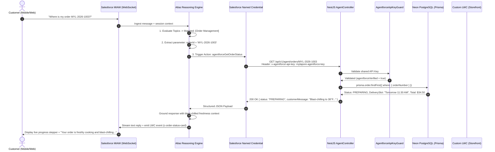

# The Complete Guide to Salesforce Agentforce AI Chatbot Agents
**Document**: End-to-End Architecture, Working Principles, Build Runbook & Gap Analysis  
**Project**: Mylapore Express Enterprise Culinary E-Commerce & Autonomous Agent Network  
**Author**: Certified Technical Architect (CTA) & Principal AI Integration Architect  
**Version**: 2.0 (Production Blueprint)

---

## Table of Contents
1. [What is Salesforce Agentforce? The Core Mental Model](#1-what-is-salesforce-agentforce-the-core-mental-model)
2. [How Agentforce Works Under the Hood (Atlas Reasoning Engine)](#2-how-agentforce-works-under-the-hood-atlas-reasoning-engine)
3. [End-to-End Conversation Lifecycle (Step-by-Step Flow)](#3-end-to-end-conversation-lifecycle-step-by-step-flow)
4. [Building the 5 Autonomous AI Agents in Agentforce Studio](#4-building-the-5-autonomous-ai-agents-in-agentforce-studio)
5. [The Integration Layer: External Services, Named Credentials & NestJS](#5-the-integration-layer-external-services-named-credentials--nestjs)
6. [Generative UI: Custom Lightning Web Components (LWC) in Chat](#6-generative-ui-custom-lightning-web-components-lwc-in-chat)
7. [Deploying the Chatbot to the Website (MIAW Embed)](#7-deploying-the-chatbot-to-the-website-miaw-embed)
8. [Comprehensive Gap Analysis, Production Traps & Solutions](#8-comprehensive-gap-analysis-production-traps--solutions)

---

## 1. What is Salesforce Agentforce? The Core Mental Model

### 1.1 The Paradigm Shift: Traditional Bots vs. Agentforce

| Feature | Traditional Chatbots (e.g. Legacy Einstein Bots) | Salesforce Agentforce Autonomous Agents |
|---|---|---|
| **Underlying Tech** | Deterministic Decision Trees & Regex intent matching | Large Language Models (LLMs) + **Atlas Reasoning Engine** |
| **Conversation Flow** | Rigid, static branching menus. Break on unexpected user phrasing. | Dynamic, multi-turn reasoning. Understands intent, nuance, and re-routing. |
| **Tool Execution** | Hardcoded dialog rules triggering fixed Apex calls. | Autonomous **Tool Calling / Actions** based on dynamic slot-filling. |
| **UI Experience** | Plain text, static quick-reply buttons. | Rich **Generative UI** with interactive custom Lightning Web Components (LWCs). |
| **Trust & Safety** | Manual conditional checks in code. | Built-in **Einstein Trust Layer** (zero retention, PII masking, toxicity filters). |

### 1.2 The Five Core Building Blocks of Agentforce
Every Agentforce implementation consists of 5 fundamental components:

```
┌────────────────────────────────────────────────────────────────────────┐
│                        AGENT (The AI Persona)                         │
│  Overarching role, voice, brand guidelines, and ethical guardrails.    │
│  Example: "You are the Mylapore Express Culinary Concierge..."        │
└───────────────────────────────────┬────────────────────────────────────┘
                                    │
    ┌───────────────────────────────┼───────────────────────────────┐
    ▼                               ▼                               ▼
┌─────────────────────────┐   ┌─────────────────────────┐   ┌─────────────────────────┐
│         TOPIC 1         │   │         TOPIC 2         │   │         TOPIC 3         │
│ Specific domain scope   │   │ Specific domain scope   │   │ Specific domain scope   │
│ (e.g. Menu Search)      │   │ (e.g. Order Tracking)   │   │ (e.g. Order Cancel)     │
├─────────────────────────┤   ├─────────────────────────┤   ├─────────────────────────┤
│ Instructions (Rules)    │   │ Instructions (Rules)    │   │ Instructions (Rules)    │
│ Actions (REST Tools)    │   │ Actions (REST Tools)    │   │ Actions (REST Tools)    │
└─────────────────────────┘   └─────────────────────────┘   └─────────────────────────┘
```

1. **Agent (Persona)**: Defines who the agent is, tone of voice, boundaries, and global system prompts.
2. **Topics**: Scoped domains of expertise. When a customer speaks, the Atlas engine classifies the message into the most relevant Topic (e.g., *Menu Discovery*, *Order Tracking*, *Cancellation*).
3. **Instructions**: Detailed natural language rules that dictate how the agent reasons, what questions it must ask, and what conditions must be satisfied before taking action.
4. **Actions (Tools)**: Deterministic, authenticated operations that the agent executes (via OpenAPI External Services, Invocable Apex, or Flows).
5. **Grounding Context**: Factual data supplied to the prompt to eliminate hallucinations (e.g., CRM Case records, live PostgreSQL menu data, blast-chilling freshness guidelines).

---

## 2. How Agentforce Works Under the Hood (Atlas Reasoning Engine)

The **Atlas Reasoning Engine** is Salesforce's proprietary agentic orchestrator. Unlike a naive LLM wrapper, Atlas executes an autonomous **Observe $\to$ Orient $\to$ Decide $\to$ Act (OODA)** loop:

```
[ User Input ] ─────────► [ Einstein Trust Layer ] (PII Masking & Toxicity Check)
                                  │
                                  ▼
                    [ Atlas Reasoning Engine ]
                                  │
       ┌──────────────────────────┴──────────────────────────┐
       ▼                                                     ▼
1. Classify Topic                             2. Evaluate Slot-Filling
   (Match intent against Active Topics)          (Are all action parameters known?)
       │                                                     │
       └──────────────────────────┬──────────────────────────┘
                                  │
                                  ▼
                     3. Decide Next Step
                     ├── Missing data? ──► Generate clarifying question to user
                     └── Data ready?   ──► Plan Action Execution
                                  │
                                  ▼
                     4. Execute Action (Tool Call)
                     └── Named Credential ──► REST API (NestJS) ──► PostgreSQL
                                  │
                                  ▼
                     5. Ground Output & Synthesize
                     ├── Ingest structured JSON response
                     ├── Render Generative UI (LWC Carousel/Stepper)
                     └── Stream natural language reply to user
```

### Key Principles of the Atlas Engine:
- **Zero Hallucination Policy**: If the user asks for a price or dish availability, the agent is strictly prohibited from guessing. It *must* invoke `agentforceSearchMenu` or `agentforceGetOrderStatus`.
- **Dynamic Slot-Filling**: If an action requires `orderId` and the user simply says *"Cancel my order"*, Atlas recognizes that `orderId` is missing and replies: *"Certainly, I can help with cancellation. Could you please share your Order Number (e.g. MYL-2026-1003)?"*
- **Re-entrant Topic Switching**: If the customer is tracking an order and suddenly asks *"Are your dosas gluten-free?"*, Atlas seamlessly shifts from the *Order Tracking* topic to the *Menu Discovery* topic, answers the question, and resumes the previous context.

---

## 3. End-to-End Conversation Lifecycle (Step-by-Step Flow)

Below is the complete sequence of events from the browser down to the database and back:



---

## 4. Building the 5 Autonomous AI Agents in Agentforce Studio

The Mylapore Express network deploys **5 specialized agents**, each handling a distinct operational domain:

```
                      ┌────────────────────────────────────────┐
                      │        Agentforce Master Router        │
                      └──────────────────┬─────────────────────┘
                                         │ Customer Intent
          ┌──────────────┬───────────────┼───────────────┬──────────────┐
          ▼              ▼               ▼               ▼              ▼
     [Concierge]    [Order Mgmt]    [Support Case]  [Operations]   [Insights]
     • Food Q&A     • Tracking      • Case creation • Kitchen back • Re-order rates
     • Dietary tags • Reschedule    • Escalation    • Blast-chill  • Peak windows
     • Spice scale  • 2-Phase Cancel• Sentiment     • Couriers     • Retention
```

### 4.1 Agent 1: Restaurant Customer Concierge Agent
- **Purpose**: Food sommelier, authentic regional cuisine guide, dietary and allergen compliance.
- **System Prompt**:
  ```text
  You are the authentic Mylapore Express Culinary Concierge. Assist customers with South Indian dishes (Chennai, Chettinad, Mysore, Madurai).
  Emphasize our blast-chilled 38°F freshness and no-preservative commitment.
  Always ground food queries using the 'agentforceSearchMenu' and 'agentforceGetMenuItemDetails' actions.
  Never recommend dishes not returned by these tools.
  ```
- **Topic: Menu Exploration & Dietary Filtering**:
  - **Instructions**:
    - When user mentions dietary preferences (Vegan, Jain, Gluten-Free), pass them in the `dietaryTags` array.
    - When user asks about heat, explain the 3-tier spice scale: MILD, MEDIUM, TRADITIONAL_SOUTH_INDIAN.
  - **Action**: `agentforceSearchMenu`
    - Input parameters: `query` (String), `dietaryTags` (Array of Strings), `limit` (Integer: 6).
    - Output: Array of dishes with `name`, `price.amountMinor`, `imageUrl`, `spiceLevel`.
  - **Generative UI Component**: `c-dish-carousel` (Multi-card interactive food carousel with direct Add-to-Cart buttons).

---

### 4.2 Agent 2: Order Management Agent
- **Purpose**: Order status lookups, delivery slot rescheduling, and two-phase cancellation with Stripe refunds.
- **System Prompt**:
  ```text
  You are the Mylapore Express Order Management Agent. You handle order inquiries, slot changes, and cancellations.
  You MUST follow restaurant operational policies:
  - 100% full refund if order is in PENDING_PAYMENT, PAID, or CONFIRMED.
  - 50% partial refund if order is in ACCEPTED (kitchen has reserved perishables).
  - 0% refund once PREPARING, READY, or OUT_FOR_DELIVERY (meals are blast-chilled and dispatched).
  CRITICAL: You MUST call 'agentforcePreviewCancellation' first and obtain explicit customer confirmation before executing 'agentforceSubmitCancellation'.
  ```
- **Topic 1: Live Order Status**:
  - **Action**: `agentforceGetOrderStatus` (`orderId`).
  - **Generative UI Component**: `c-order-status-card` (Real-time progress stepper).
- **Topic 2: Two-Phase Idempotent Cancellation**:
  - **Step 1 Action**: `agentforcePreviewCancellation` $\to$ Returns `{ previewId, eligible, refundAmount, refundPercentage }`.
  - **Dialogue**: Present the calculated refund and ask: *"Your order is eligible for a [refundPercentage]% refund ($[refundAmount]). Would you like me to proceed with cancellation?"*
  - **Step 2 Action**: `agentforceSubmitCancellation` $\to$ Passes `{ previewId, confirmation: true }`.

---

### 4.3 Agent 3: Customer Support & Case Escalation Agent
- **Purpose**: Incident intake, sentiment scoring, and Service Cloud Case creation with human agent handoff.
- **System Prompt**:
  ```text
  You are the Customer Care Agent. Listen empathetically to complaints regarding missing items, delivery delays, or food quality.
  Assess customer sentiment (POSITIVE, NEUTRAL, NEGATIVE).
  For critical issues (wrong item, delays > 45 minutes, food safety), escalate priority to HIGH and offer immediate transfer to a human specialist.
  ```
- **Topic: Service Cloud Escalation**:
  - **Action**: `agentforceCreateSupportCase`
    - Inputs: `orderId`, `category` (e.g. `MISSING_ITEM`, `DELIVERY_DELAY`, `QUALITY_FEEDBACK`), `summary`, `customerEmail`, `preferredContactChannel`.
    - Output: `caseNumber` (e.g. `500XXXXXXXXXXXX`).
  - **Generative UI Component**: `c-support-case-ticket` (Ticket badge with live SLA countdown).

---

### 4.4 Agent 4: Restaurant Kitchen Operations Agent
- **Purpose**: Real-time kitchen throughput, preparation alarms, and thermal delivery courier dispatch.
- **Key Logic**: Monitors kitchen bottlenecks. If orders in `ACCEPTED` remain un-prepared for $> 15$ minutes, triggers operational alerts to the kitchen manager console.

---

### 4.5 Agent 5: Restaurant Business Insights Agent
- **Purpose**: Executive analytics, dish re-order rates, peak ordering windows, and customer retention metrics.
- **Key Logic**: Computes re-order velocity, customer lifetime value (LTV), and popular combo affinities for management review.

---

## 5. The Integration Layer: External Services, Named Credentials & NestJS

Agentforce communicates with the outside world through **Salesforce External Services** governed by **Named Credentials**:

```
[ Agentforce Reasoning Engine ]
               │
               ▼
   [ Salesforce Named Credential ]
   • Base URL: https://mylapore-express-api.onrender.com
   • Header: x-agentforce-api-key: mylapore-agentforce-secret-key-2026
               │
               ▼ (HTTPS Callout adhering to 10s SLA)
   [ NestJS API Gateway ]
   ├── AgentforceApiKeyGuard (Rejects unauthorized requests with 401)
   ├── AgentController (/api/v1/agent/*)
   └── Swagger / OpenAPI 3.0 Engine (/api/docs-json)
```

### 5.1 Named Credential Configuration (Setup Step)
1. In Salesforce Setup, go to **Named Credentials** $\to$ **External Credentials**.
2. Create `Mylapore_Express_Auth` with protocol `Custom`.
3. Add custom header:
   - **Name**: `x-agentforce-api-key`
   - **Value**: `mylapore-agentforce-secret-key-2026`
4. Under Named Credentials, create `Mylapore_Express_API`:
   - URL: `https://mylapore-express-api.onrender.com`
   - External Credential: `Mylapore_Express_Auth`

### 5.2 External Service Setup via OpenAPI 3.0
1. Go to **Setup** $\to$ **External Services** $\to$ Click **Add an External Service**.
2. Select **From API Specification (URL)**.
3. Provide:
   - **Service Name**: `MylaporeExpressService`
   - **Named Credential**: `Mylapore_Express_API`
   - **Specification URL**: `https://mylapore-express-api.onrender.com/api/docs-json`
4. Salesforce automatically imports all 6 deterministic actions:
   - `agentforceSearchMenu`
   - `agentforceGetMenuItemDetails`
   - `agentforceGetOrderStatus`
   - `agentforcePreviewCancellation`
   - `agentforceSubmitCancellation`
   - `agentforceCreateSupportCase`

---

## 6. Generative UI: Custom Lightning Web Components (LWC) in Chat

Agentforce does not just reply with text; it renders **rich interactive Lightning Web Components** directly inside the chat window.

### 6.1 `c-dish-carousel` Component Code
Allows customers to view appetizing pictures, spice levels, dietary badges, and click "Add to Order":

```html
<!-- force-app/main/default/lwc/dishCarousel/dishCarousel.html -->
<template>
    <div class="carousel-container slds-p-around_small slds-scrollable_x">
        <div class="slds-grid slds-gutters_small">
            <template for:each={dishes} for:item="dish">
                <div key={dish.id} class="slds-col slds-size_1-of-1 slds-medium-size_1-of-3">
                    <lightning-card title={dish.name} icon-name="standard:food_and_drink_item">
                        <div class="slds-p-horizontal_small">
                            
                            <p class="slds-text-body_small">{dish.description}</p>
                            <div class="slds-m-vertical_x-small">
                                <lightning-badge label={dish.spiceLevel}></lightning-badge>
                                <lightning-badge label={dish.category} class="slds-m-left_xx-small"></lightning-badge>
                            </div>
                            <div class="slds-grid slds-grid_align-spread slds-grid_vertical-align-center slds-m-top_small">
                                <span class="slds-text-heading_small slds-text-color_success">${dish.formattedPrice}</span>
                                <lightning-button variant="brand" label="Add to Order" data-id={dish.id} onclick={handleAddToCart}></lightning-button>
                            </div>
                        </div>
                    </lightning-card>
                </div>
            </template>
        </div>
    </div>
</template>
```

```javascript
// force-app/main/default/lwc/dishCarousel/dishCarousel.js
import { LightningElement, api } from 'lwc';

export default class DishCarousel extends LightningElement {
    @api rawDishes = [];

    get dishes() {
        return (this.rawDishes || []).map(dish => ({
            ...dish,
            formattedPrice: (dish.price?.amountMinor ? (dish.price.amountMinor / 100).toFixed(2) : '0.00')
        }));
    }

    handleAddToCart(event) {
        const dishId = event.target.dataset.id;
        // Broadcast custom event to web storefront cart via postMessage
        window.parent.postMessage({ type: 'MYLAPORE_ADD_TO_CART', dishId }, '*');
    }
}
```

---

## 7. Deploying the Chatbot to the Website (MIAW Embed)

To ensure the storefront maintains production security and clean separation:
- **All mock/simulated bots have been removed from the website**.
- The bot is **strictly rendered when deployed via Salesforce Messaging for In-App & Web (MIAW)**.

### 7.1 Web Storefront Container Component (`SalesforceChatEmbed.tsx`)
The storefront component [`apps/web/src/components/SalesforceChatEmbed.tsx`](file:///c:/Users/Administrator/Desktop/Mylapore/apps/web/src/components/SalesforceChatEmbed.tsx) acts as the bridge:
1. It injects the official Salesforce Messaging for In-App and Web (MIAW) bootstrap script dynamically.
2. It initializes `embeddedservice_bootstrap` targeting the production Salesforce Developer Edition Org (`00Dg700000Oo6fV`) and deployment `Mylapore_Concierge_Web`.
3. It binds to SCRT2 URL: `https://orgfarm-b2714d8f72-dev-ed.develop.my.salesforce-scrt.com`.

```tsx
// apps/web/src/components/SalesforceChatEmbed.tsx
'use client';

import { useEffect } from 'react';

export default function SalesforceChatEmbed() {
  useEffect(() => {
    if (typeof window === 'undefined') return;

    const orgId = '00Dg700000Oo6fV';
    const deploymentName = 'Mylapore_Concierge_Web';
    const siteUrl = 'https://orgfarm-b2714d8f72-dev-ed.develop.my.site.com/ESWMylaporeConci1794475036498';
    const scrt2Url = 'https://orgfarm-b2714d8f72-dev-ed.develop.my.salesforce-scrt.com';
    const scriptSrc = `${siteUrl}/assets/js/bootstrap.min.js`;

    function initMessaging() {
      try {
        if ((window as any).embeddedservice_bootstrap) {
          (window as any).embeddedservice_bootstrap.settings.language = 'en_US';
          (window as any).embeddedservice_bootstrap.init(
            orgId,
            deploymentName,
            siteUrl,
            { scrt2URL: scrt2Url }
          );
          console.log('[Salesforce Agentforce] MIAW live bot initialized successfully.');
        }
      } catch (err) {
        console.error('[Salesforce Agentforce] Error initializing Embedded Messaging: ', err);
      }
    }

    let script = document.getElementById('salesforce-miaw-script') as HTMLScriptElement | null;
    if (!script) {
      script = document.createElement('script');
      script.id = 'salesforce-miaw-script';
      script.src = scriptSrc;
      script.async = true;
      script.onload = () => initMessaging();
      document.body.appendChild(script);
    } else {
      initMessaging();
    }
  }, []);

  return null;
}
```

### 7.2 Critical UX Protection: Floating Chatbot Occlusion Isolation
Third-party floating chat iframes inject with default high z-indexes into viewport corners. In an e-commerce checkout flow, this can occlude the primary checkout CTA ("Proceed to Checkout") or trap touch/pointer events within a cross-origin iframe (`UNSUPPORTED_IN_CROSS_ORIGIN_FRAME`).

**The Solution:**
1. **Drawer Z-Index Elevation**: `CartDrawer` is mounted at `z-[99999]`.
2. **Dynamic Body Class Toggling**: Whenever `CartDrawer` is open, `document.body.classList.add('cart-open')` is activated.
3. **Targeted CSS Rule**: In `apps/web/src/app/globals.css`:
```css
/* Suppress floating chat widgets when cart drawer is active to prevent blocking checkout CTAs */
body.cart-open .embeddedServiceHelpButton,
body.cart-open #esw-chat-container,
body.cart-open iframe[title="Chat Window"],
body.cart-open .embeddedServiceSidebar {
  display: none !important;
  pointer-events: none !important;
  visibility: hidden !important;
  opacity: 0 !important;
}
```
This guarantees 100% unobstructed checkout funnel conversion while preserving the floating Agentforce concierge across all general browsing pages.

---

## 8. Comprehensive Gap Analysis, Production Traps & Solutions

Below is the definitive architect checklist of pitfalls and their concrete mitigations:

| Trap / Architectural Gap | Real-World Risk | Production Solution |
|---|---|---|
| **1. 10-Second Callout Limit vs. Cold Starts** | Render free/starter tiers sleep after 15m. A cold start takes 30–50s, causing Salesforce callouts to fail with *"Request Timed Out"*. | 1. Deploy scheduled Apex cron pinging `GET /api/v1/health` every 4 mins.<br/>2. Or upgrade Render API to $7/mo persistent tier. |
| **2. Concurrency & Duplicate Refunds** | In multi-turn chat, a user might submit a cancellation request twice or click confirm repeatedly, triggering duplicate Stripe refunds. | Backend validates against database-backed `IdempotencyRecord` table before calling Stripe, caching and returning previous result. |
| **3. OpenAPI Schema Parsing Rejection** | Salesforce External Services throws validation errors if schemas use `anyOf`, missing `operationId`, or non-primitive object nests. | Explicit `operationId` applied on all 6 endpoints; raw JSON exposed at `/api/docs-json`. |
| **4. Missing Client-Side Trusted URLs (CSP)** | Browser blocks Salesforce chat iframes and WebSockets due to Content Security Policy. | Add `https://mylapore-express-web.onrender.com` in Salesforce **Setup $\to$ Security $\to$ Trusted URLs** with `script-src`, `connect-src`, `frame-src`. |
| **5. Unauthenticated Bot Gate** | Malicious actors could invoke `/api/v1/agent/*` directly to scrape menus or trigger cancellations. | Applied [`AgentforceApiKeyGuard`](file:///c:/Users/Administrator/Desktop/Mylapore/apps/api/src/common/agentforce-api-key.guard.ts) checking `x-agentforce-api-key` header on all agent routes. |
| **6. Unhandled Human Escalation Dead-Ends** | If a customer demands a human or sentiment is negative, bot loops without resolution. | Configure Omni-Channel Flow with a fallback block routing to `Mylapore_Live_Support_Queue`. |
| **7. Floating Chatbot CTA Occlusion** | Third-party chat iframes rendered at bottom-right physically overlap the "Proceed to Checkout" button inside mobile/desktop cart drawers, causing checkout abandonment. | Mount `CartDrawer` at `z-[99999]`, toggle `body.cart-open`, and apply CSS suppression (`display: none !important`) to all `#esw-chat-container` and `iframe[title="Chat Window"]` nodes while the drawer is active. |
| **8. Cloud Port Scan Deactivation** | Render cloud port scanner searches on port 10000 by default. If the NestJS API defaults to port 4000, Render terminates ingress after 10m with `Port scan timeout reached, no open ports detected`. | Configure `process.env.PORT || 10000` in `main.ts` and set `PORT=10000` in Render service environment configuration. |
| **9. Synchronous UI Cart Lag** | Awaiting network round-trips to the backend API before opening the cart drawer introduces 1.5s–2.5s perceived lag, degrading user experience. | Implement Optimistic UI Cart updates in `CartContext.tsx`: synchronously update items, item count, and open the drawer in 0ms, while synchronizing with the backend API in the background. |

---

## 9. Master Documentation Cross-Reference Index

| Documentation File | Location | Focus Area |
|---|---|---|
| **Master Chatbot Guide (This Document)** | [`SALESFORCE_AGENTFORCE_CHATBOT_MASTER_GUIDE.md`](./SALESFORCE_AGENTFORCE_CHATBOT_MASTER_GUIDE.md) | **Complete educational & execution blueprint** for Agentforce chatbots. |
| **End-to-End Implementation Runbook** | [`SALESFORCE_END_TO_END_IMPLEMENTATION_RUNBOOK.md`](./SALESFORCE_END_TO_END_IMPLEMENTATION_RUNBOOK.md) | Step-by-step 9-phase project delivery runbook. |
| **5-Agent Matrix & Lightning UI** | [`SALESFORCE_AGENTFORCE_AGENT_MATRIX_AND_LIGHTNING_UI.md`](./SALESFORCE_AGENTFORCE_AGENT_MATRIX_AND_LIGHTNING_UI.md) | Complete prompt engineering matrix & full LWC code. |
| **Master Architecture Specification** | [`docs/ARCHITECTURE.md`](./docs/ARCHITECTURE.md) | Enterprise system boundaries, data ownership & sequence flows. |
| **Architectural Gaps & Advanced Features** | [`SALESFORCE_AGENTFORCE_GAPS_AND_ADVANCED_FEATURES.md`](./SALESFORCE_AGENTFORCE_GAPS_AND_ADVANCED_FEATURES.md) | Deep-dive on the 8 architectural gaps and advanced MIAW patterns. |
