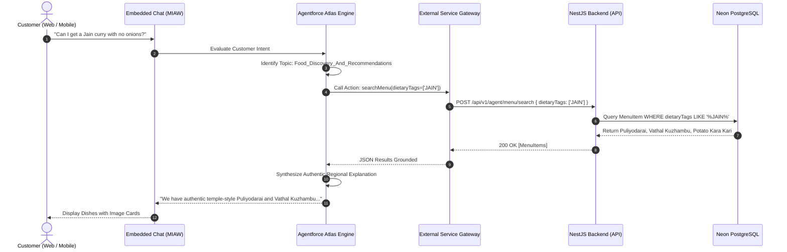

# Salesforce Agentforce: Architectural Gaps, Advanced Features & Lightning UI Specification

> **Repository**: `Mylapore Express Enterprise Culinary Platform`  
> **Document Type**: Comprehensive Architectural Gap Analysis, Advanced Capabilities & Salesforce Lightning Engineering Blueprint  
> **Companion Document**: [`SALESFORCE_AGENTFORCE_DEVELOPER_GUIDE.md`](./SALESFORCE_AGENTFORCE_DEVELOPER_GUIDE.md)  
> **Target Audience**: Salesforce Technical Architects, Lead Agentforce Developers, Full-Stack Engineers, DevOps & Security Leads  
> **Status**: Production Audit & Implementation Roadmap

---

## 1. Executive Gap Matrix & Risk Audit

| # | Gap Area | Current Repo State | Production Risk | Architectural Severity | Target Remediation |
|---|---|---|---|:---:|---|
| **GAP-01** | **Agent Gateway Security** | `AgentController` has no `@UseGuards()`. Open to public internet. | Malicious callers can cancel orders, trigger refunds, or flood support tickets. | 🔴 **CRITICAL** | Implement `AgentforceApiKeyGuard` + Salesforce Named Credentials custom header. |
| **GAP-02** | **Chat Disconnect** | `ChatWidget.tsx` calls local regex matching in `support.service.ts`. | Customer chat does not communicate with Salesforce Agentforce reasoning engine. | 🔴 **CRITICAL** | Embed Salesforce MIAW (Messaging for Web) or deploy a Headless Connect API proxy. |
| **GAP-03** | **Callout Timeout** | Backend on Render free tier sleeps after 15m; cold start takes 30–45s. | Agentforce External Service has a 10s synchronous limit; turns crash with timeout. | 🔴 **CRITICAL** | Deploy keep-alive daemon ping or upgrade Render compute tier to persistent. |
| **GAP-04** | **Unidirectional Sync** | Outbox pushes Postgres ➔ SF, but SF has no webhook back to Postgres. | Changes made in Service Cloud (cancellations, refunds) never reflect in web app or KDS. | 🟠 **HIGH** | Build `POST /api/v1/integrations/salesforce/webhook` with HMAC verification. |
| **GAP-05** | **OpenAPI Strictness** | Endpoints in `AgentController` lack explicit `operationId` tags. | Salesforce External Services registration fails or generates unreadable Apex actions. | 🟠 **HIGH** | Decorate all endpoints with unambiguous `operationId` and typed DTOs. |
| **GAP-06** | **Financial Idempotency** | `submitCancellation` does not verify `IdempotencyRecord` table before refund. | Repeated chat prompts (*"Cancel it!"*) can cause duplicate Stripe refund execution. | 🟠 **HIGH** | Enforce database-level idempotency lock on `previewId` with 60-second window. |
| **GAP-07** | **Multi-Turn Memory** | No session correlation token mapped between Agentforce turn & cart context. | Customer loses dietary preferences or cart state across successive messages. | 🟡 **MEDIUM** | Implement `SessionContextDTO` containing `sessionToken`, `outletId`, and `dietaryTags`. |
| **GAP-08** | **Omni-Channel Handoff** | Support cases created without conversation transcript or intent history. | Service Cloud live agents lack context when human handoff occurs; customers repeat themselves. | 🟡 **MEDIUM** | Pass serialized conversation turns into `Case.Description` and `Agent_Interaction__c`. |

---

## 2. Detailed Gap Analysis & Code Remediation Blueprint

### Gap 1: Insecure Agent Gateway Endpoints

#### The Flaw
In `apps/api/src/agent/agent.controller.ts`:
```typescript
@ApiTags('Agent Gateway')
@Controller('agent') // NO GUARD ATTACHED
export class AgentController {
  @Post('orders/:orderId/cancellation')
  async submitCancellation(...) { ... }
}
```
Any script on the internet can POST to `https://mylapore-express-api.onrender.com/api/v1/agent/orders/MYL-2026-1003/cancellation` and trigger an automated cancellation and financial refund.

#### Production Remediation: `AgentforceApiKeyGuard`

Create `apps/api/src/common/agentforce-auth.guard.ts`:
```typescript
import { Injectable, CanActivate, ExecutionContext, UnauthorizedException } from '@nestjs/common';

@Injectable()
export class AgentforceApiKeyGuard implements CanActivate {
  canActivate(context: ExecutionContext): boolean {
    const request = context.switchToHttp().getRequest();
    const authHeader = request.headers['x-agentforce-api-key'];
    const expectedKey = process.env.AGENTFORCE_API_KEY;

    if (!expectedKey) {
      throw new UnauthorizedException('AGENTFORCE_API_KEY not configured on server');
    }

    if (!authHeader || authHeader !== expectedKey) {
      throw new UnauthorizedException('Unauthorized Agentforce invocation: Invalid or missing API key');
    }

    return true;
  }
}
```

Apply to `AgentController`:
```typescript
@ApiTags('Agent Gateway')
@ApiHeader({ name: 'X-Agentforce-Api-Key', required: true, description: 'Pre-shared secret configured in Salesforce Named Credential' })
@UseGuards(AgentforceApiKeyGuard)
@Controller('agent')
export class AgentController { ... }
```

In Salesforce Setup:
1. Navigate to **Named Credentials** ➔ **New Named Credential**.
2. URL: `https://mylapore-express-api.onrender.com`.
3. Add Custom Header: `X-Agentforce-Api-Key` with value matching `AGENTFORCE_API_KEY`.

---

### Gap 2: Frontend Chat Disconnect (MIAW vs. Headless)

#### The Problem
`apps/web/src/components/ChatWidget.tsx` currently sends messages to `/support/chat` which parses regular expressions. It does not engage the Salesforce Agentforce Atlas Reasoning Engine.

#### Architectural Path A: Salesforce MIAW (Recommended Enterprise Pattern)
Salesforce Embedded Messaging for Web provides native chat routing, typing indicators, pre-chat forms, and direct execution of Agentforce topics.

To embed inside `apps/web/src/components/SalesforceMIAWChat.tsx`:
```tsx
'use client';

import { useEffect } from 'react';

declare global {
  interface Window {
    embeddedservice_bootstrap?: any;
  }
}

export default function SalesforceMIAWChat() {
  useEffect(() => {
    const script = document.createElement('script');
    script.src = 'https://mylaporeexpress.my.site.com/ESWMessaging1700000000/assets/js/bootstrap.min.js';
    script.async = true;
    script.onload = () => {
      try {
        window.embeddedservice_bootstrap.settings.language = 'en_US';
        window.embeddedservice_bootstrap.init(
          '00DXXXXXXXXXXXXXXX', // Org ID
          'Mylapore_Express_Agentforce', // Deployment Name
          'https://mylaporeexpress.my.site.com/ESWMessaging1700000000',
          { scrt2URL: 'https://mylaporeexpress.my.salesforce-scrt.com' }
        );
      } catch (err) {
        console.error('Failed to initialize Salesforce MIAW', err);
      }
    };
    document.body.appendChild(script);

    return () => {
      document.body.removeChild(script);
    };
  }, []);

  return null; // Salesforce bootstrap injects its own floating UI
}
```

#### Architectural Path B: Headless Agentforce Connect API Proxy
If you want to keep the custom South Indian sand/terracotta Tailwind UI:
1. Client sends message to Next.js API route `/api/chat`.
2. Next.js calls NestJS `POST /api/v1/agent/conversation`.
3. NestJS exchanges a private key JWT with Salesforce Connected App (`/services/oauth2/token`).
4. NestJS posts to `/services/data/v61.0/connect/conversation/${conversationId}/messages`.
5. Returns streaming Agentforce reply to the React UI.

---

### Gap 3: Render Free Tier Cold Starts vs. Salesforce 10-Second Callout Limit

#### The Constraint
* **Salesforce Action Limit**: External Service calls from Agentforce have a hard **10-second timeout** for interactive turns.
* **Render Free Tier Behavior**: Inactive services enter suspended state; cold wake-up takes **30–45 seconds**.
* **Impact**: If a customer chats after a lull, the first turn will consistently fail with an HTTP 504/timeout error.

#### Solutions
1. **Production Hosting**: Upgrade `mylapore-express-api` to Render **Starter tier ($7/mo)** or Railway non-sleeping container (always hot).
2. **Automated Keep-Alive Worker**: Deploy a cron job pinging `/api/v1/health` every 8 minutes:
   ```bash
   # Crontab / GitHub Actions keepalive
   */8 * * * * curl -s -f https://mylapore-express-api.onrender.com/api/v1/health > /dev/null
   ```

---

### Gap 4: Missing Inbound Salesforce Webhook (Bidirectional Sync)

#### The Problem
When a customer support agent in Salesforce Service Cloud changes order status to `CANCELLED` or modifies delivery details, PostgreSQL never receives the update. The customer's order tracking screen stays in the old state.

#### Production Remediation: NestJS Inbound Webhook

Add `apps/api/src/integrations/salesforce-webhook.controller.ts`:
```typescript
import { Controller, Post, Body, Headers, UnauthorizedException, Logger } from '@nestjs/common';
import { PrismaService } from '../prisma/prisma.service';
import * as crypto from 'crypto';

@Controller('integrations/salesforce')
export class SalesforceWebhookController {
  private logger = new Logger(SalesforceWebhookController.name);

  constructor(private prisma: PrismaService) {}

  @Post('webhook')
  async handleSalesforceEvent(
    @Body() payload: any,
    @Headers('x-salesforce-hmac-sha256') signature: string
  ) {
    const secret = process.env.SALESFORCE_WEBHOOK_SECRET || 'mylapore_sf_webhook_secret_2026';
    
    // HMAC-SHA256 signature verification
    const expectedSig = crypto
      .createHmac('sha256', secret)
      .update(JSON.stringify(payload))
      .digest('base64');

    if (!signature || signature !== expectedSig) {
      throw new UnauthorizedException('Invalid Salesforce Webhook signature');
    }

    const { eventType, orderNumber, newStatus, agentNotes, refundAmount } = payload;
    this.logger.log(`[Salesforce Webhook] Event: ${eventType} for Order ${orderNumber} -> Status: ${newStatus}`);

    const order = await this.prisma.order.findUnique({
      where: { orderNumber }
    });

    if (!order) {
      return { status: 'IGNORED_ORDER_NOT_FOUND' };
    }

    // Update order status and append audit history
    await this.prisma.$transaction([
      this.prisma.order.update({
        where: { id: order.id },
        data: {
          status: newStatus,
          paymentStatus: newStatus === 'CANCELLED' ? 'REFUNDED' : order.paymentStatus
        }
      }),
      this.prisma.orderStatusHistory.create({
        data: {
          orderId: order.id,
          status: newStatus,
          note: `Updated via Salesforce Service Cloud: ${agentNotes || 'Agent action'}`,
          createdBy: 'SALESFORCE_AGENTFORCE'
        }
      })
    ]);

    return { status: 'PROCESSED', orderNumber, newStatus };
  }
}
```

#### Salesforce Apex Callout Trigger
In Salesforce, configure an Apex trigger or Flow on `Restaurant_Order__c`:
```java
trigger RestaurantOrderTrigger on Restaurant_Order__c (after update) {
    for (Restaurant_Order__c ord : Trigger.new) {
        Restaurant_Order__c oldOrd = Trigger.oldMap.get(ord.Id);
        if (ord.Status__c != oldOrd.Status__c) {
            SalesforceWebhookPublisher.publishStatusChange(ord.Name, ord.Status__c, ord.Notes__c);
        }
    }
}
```

---

### Gap 5: OpenAPI Schema Strictness for Salesforce External Services

#### Required Changes in `apps/api/src/agent/agent.controller.ts`

Salesforce External Services strictly requires `operationId` on every route. Update all routes:

```typescript
@Post('menu/search')
@ApiOperation({
  operationId: 'searchMenu',
  summary: 'Search authentic menu for dietary options'
})
async searchMenu(@Body() body: SearchMenuDto) { ... }

@Get('orders/:orderId')
@ApiOperation({
  operationId: 'getOrderStatus',
  summary: 'Get real-time order status and delivery window'
})
async getOrderStatus(@Param('orderId') orderId: string) { ... }

@Post('orders/:orderId/cancellation-preview')
@ApiOperation({
  operationId: 'previewCancellation',
  summary: 'Evaluate cancellation fee and refund percentage'
})
async previewCancellation(@Param('orderId') orderId: string) { ... }

@Post('orders/:orderId/cancellation')
@ApiOperation({
  operationId: 'submitCancellation',
  summary: 'Execute confirmed order cancellation'
})
async submitCancellation(@Param('orderId') orderId: string, @Body() body: CancellationDto) { ... }

@Post('support/cases')
@ApiOperation({
  operationId: 'createSupportCase',
  summary: 'Create verified support case in Service Cloud'
})
async createSupportCase(@Body() body: SupportCaseDto) { ... }
```

---

### Gap 6: Concurrency & Idempotency Locking for Financial Actions

#### The Flaw
If Agentforce executes two rapid calls to `submitCancellation` due to user repeated prompts, two Stripe refund calls could fire in parallel.

#### Remediation in `agent.service.ts`
```typescript
async submitCancellation(orderIdOrNumber: string, body: { previewId: string; confirmation: boolean; reasonCode?: string }) {
  const idempotencyKey = `cancel_${body.previewId}`;

  // 1. Check idempotency table
  const existing = await this.prisma.idempotencyRecord.findUnique({
    where: { key: idempotencyKey }
  });
  if (existing) {
    return JSON.parse(existing.responseBody);
  }

  // 2. Validate preview expiration
  const preview = this.previews.get(body.previewId);
  if (!preview || new Date() > preview.expiresAt) {
    throw new BadRequestException('Cancellation preview has expired. Please request a new preview.');
  }

  // 3. Execute cancellation & record in Prisma transaction
  const result = await this.ordersService.cancelOrder(orderIdOrNumber, body.reasonCode || 'AGENTFORCE_CANCEL');

  const responsePayload = {
    success: true,
    orderNumber: result.order.orderNumber,
    status: result.order.status,
    refundIssued: result.order.total,
    timestamp: new Date().toISOString()
  };

  // 4. Save idempotency record
  await this.prisma.idempotencyRecord.create({
    data: {
      key: idempotencyKey,
      scope: 'ORDER_CANCELLATION',
      responseBody: JSON.stringify(responsePayload),
      statusCode: 202
    }
  });

  return responsePayload;
}
```

---

## 3. Salesforce Lightning UI Components (LWC)

To provide a unified experience across **Salesforce Service Cloud Console**, **Kitchen Operations KDS**, and **Experience Cloud Customer Portals**, the following Lightning Web Components must be deployed.

```
                          LIGHTNING UI ARCHITECTURE
  ┌────────────────────────────────────────────────────────────────────────┐
  │                        LIGHTNING RECORD PAGE                           │
  │                     (Restaurant_Order__c Record)                       │
  │                                                                        │
  │  ┌───────────────────────────────┐  ┌───────────────────────────────┐  │
  │  │  orderTrackerMapLwc           │  │  customerReheatingCardLwc     │  │
  │  │  - Visual 6-Stage Progress    │  │  - Blast-Chilled Temp (38°F)  │  │
  │  │  - Milestone Timestamps       │  │  - Stovetop/Microwave Guide   │  │
  │  └───────────────────────────────┘  └───────────────────────────────┘  │
  │                                                                        │
  │  ┌───────────────────────────────┐  ┌───────────────────────────────┐  │
  │  │  omniChannelAgentforceWidget  │  │  kitchenOpsConsoleLwc         │  │
  │  │  - Transcript & Sentiment     │  │  - 15m Timeout Delay Alarm    │  │
  │  │  - One-Click Refund Action    │  │  - Out-for-Delivery Dispatch  │  │
  │  └───────────────────────────────┘  └───────────────────────────────┘  │
  └────────────────────────────────────────────────────────────────────────┘
```

---

### LWC 1: `orderTrackerMapLwc` (Visual Milestone Tracker)

Displays the live 6-stage order progression on the `Restaurant_Order__c` Lightning Record Page.

#### `orderTrackerMapLwc.html`
```html
<template>
    <lightning-card title="Mylapore Express Live Order Journey" icon-name="custom:custom68">
        <div class="slds-p-around_medium">
            <!-- Stage Indicator -->
            <lightning-progress-indicator current-step={currentStage} type="path" variant="base">
                <lightning-progress-step label="Confirmed" value="CONFIRMED"></lightning-progress-step>
                <lightning-progress-step label="Accepted" value="ACCEPTED"></lightning-progress-step>
                <lightning-progress-step label="Preparing (38°F)" value="PREPARING"></lightning-progress-step>
                <lightning-progress-step label="Ready" value="READY"></lightning-progress-step>
                <lightning-progress-step label="Out for Delivery" value="OUT_FOR_DELIVERY"></lightning-progress-step>
                <lightning-progress-step label="Delivered" value="DELIVERED"></lightning-progress-step>
            </lightning-progress-indicator>

            <!-- Metadata Details -->
            <div class="slds-grid slds-gutters slds-m-top_medium slds-box slds-theme_shade">
                <div class="slds-col slds-size_1-of-3">
                    <span class="slds-text-title_bold">Order Number:</span>
                    <p class="slds-text-body_regular">{orderNumber}</p>
                </div>
                <div class="slds-col slds-size_1-of-3">
                    <span class="slds-text-title_bold">Delivery Window:</span>
                    <p class="slds-text-body_regular">{deliverySlot}</p>
                </div>
                <div class="slds-col slds-size_1-of-3">
                    <span class="slds-text-title_bold">Freshness Advisory:</span>
                    <p class="slds-text-color_success slds-text-body_regular">❄️ Blast-Chilled at 38°F</p>
                </div>
            </div>
        </div>
    </lightning-card>
</template>
```

#### `orderTrackerMapLwc.js`
```javascript
import { LightningElement, api, wire } from 'lwc';
import { getRecord, getFieldValue } from 'lightning/uiRecordApi';

import STATUS_FIELD from '@salesforce/schema/Restaurant_Order__c.Status__c';
import ORDER_NUM_FIELD from '@salesforce/schema/Restaurant_Order__c.Name';
import SLOT_FIELD from '@salesforce/schema/Restaurant_Order__c.Delivery_Slot__c';

export default class OrderTrackerMapLwc extends LightningElement {
    @api recordId;

    @wire(getRecord, { recordId: '$recordId', fields: [STATUS_FIELD, ORDER_NUM_FIELD, SLOT_FIELD] })
    order;

    get currentStage() {
        return getFieldValue(this.order.data, STATUS_FIELD) || 'CONFIRMED';
    }

    get orderNumber() {
        return getFieldValue(this.order.data, ORDER_NUM_FIELD);
    }

    get deliverySlot() {
        return getFieldValue(this.order.data, SLOT_FIELD);
    }
}
```

---

### LWC 2: `customerReheatingCardLwc` (Blast-Chilled Freshness & Reheating)

Empowers Service Cloud agents to instantly view and recite dish-specific reheating and allergen guidelines to callers.

#### `customerReheatingCardLwc.html`
```html
<template>
    <lightning-card title="Culinary Handling & Reheating Protocol" icon-name="utility:frozen">
        <div class="slds-p-around_medium">
            <div class="slds-scoped-notification slds-scoped-notification_light slds-media slds-media_center slds-m-bottom_small">
                <div class="slds-media__figure">
                    <lightning-icon icon-name="utility:info" size="small"></lightning-icon>
                </div>
                <div class="slds-media__body">
                    <p>All dishes are preservative-free and cooled to 38°F to lock in flavor. Reheat to 165°F before serving.</p>
                </div>
            </div>

            <!-- Tabbed Reheating -->
            <lightning-tabset>
                <lightning-tab label="Stovetop Pan (Recommended)">
                    <p class="slds-p-around_x-small">Heat skillet on medium with 1 tsp oil/ghee. Sauté curries or poriyal for 3–4 minutes until sizzling hot.</p>
                </lightning-tab>
                <lightning-tab label="Microwave">
                    <p class="slds-p-around_x-small">Transfer to microwave-safe bowl. Sprinkle a few drops of water, cover loosely, heat on HIGH for 90–120 seconds.</p>
                </lightning-tab>
                <lightning-tab label="Tiffin / Batters">
                    <p class="slds-p-around_x-small">Bring Idly/Dosa batter to room temperature (30 mins). Pour on hot griddle (cast iron recommended) with sesame oil.</p>
                </lightning-tab>
            </lightning-tabset>
        </div>
    </lightning-card>
</template>
```

---

### LWC 3: `kitchenOpsConsoleLwc` (Kitchen Dispatch & Timeout Monitor)

Used by the Restaurant Operations Agent and managers in the Service Console to identify delayed orders.

```javascript
import { LightningElement, track } from 'lwc';
import getPendingAcceptanceOrders from '@salesforce/apex/KitchenOpsController.getPendingAcceptanceOrders';

export default class KitchenOpsConsoleLwc extends LightningElement {
    @track pendingOrders = [];

    connectedCallback() {
        this.pollOrders();
        setInterval(() => this.pollOrders(), 30000); // 30s auto-refresh
    }

    async pollOrders() {
        try {
            this.pendingOrders = await getPendingAcceptanceOrders();
        } catch (err) {
            console.error('KDS poll failed', err);
        }
    }
}
```

---

## 4. Advanced Agentforce Features Blueprint

### 4.1 Multi-Turn Conversational Grounding & Atlas Reasoning



### 4.2 Proactive Event-Driven Notifications (Digital Engagement / WhatsApp)

When orders transition in PostgreSQL, `IntegrationEvent` triggers outbound WhatsApp alerts via Salesforce Marketing Cloud / Digital Engagement:

1. **Order Confirmed**:  
   *"Vanakkam Anand! Your order #MYL-2026-1003 is confirmed. Our chefs are preparing your authentic South Indian meal."*
2. **Blast-Chilled to 38°F**:  
   *"Your meals are blast-chilled at 38°F and packed into insulated cooling totes with dry coolant."*
3. **Out for Delivery**:  
   *"Your driver is en route. Scheduled arrival: Today, 6:00 PM – 7:00 PM."*

### 4.3 Zero-Copy / Data Cloud Culinary Intelligence

* Map Postgres `Order` and `OrderItem` tables to **Salesforce Data Cloud Data Streams**.
* Compute:
  * **Dish Re-order Cohorts**: Track how many customers who ordered *Murungai Keerai Kootu* re-ordered within 14 days.
  * **Churn Prediction**: Alarms on customers who haven't ordered in 28 days for automated promotional offers (`WELCOME5`).

---

## 5. End-to-End Verification & Runbook

### Step 1: Verify API Key Security on Agent Controller
```bash
# 1. Negative Test: Call without API Key (Expected: 401 Unauthorized)
curl -i -X POST https://mylapore-express-api.onrender.com/api/v1/agent/menu/search \
  -H "Content-Type: application/json" \
  -d '{"query":"kurma"}'

# 2. Positive Test: Call with valid pre-shared Named Credential Key (Expected: 200 OK)
curl -i -X POST https://mylapore-express-api.onrender.com/api/v1/agent/menu/search \
  -H "Content-Type: application/json" \
  -H "X-Agentforce-Api-Key: mylapore_agentforce_secret_key_2026" \
  -d '{"query":"kurma"}'
```

### Step 2: Verify Cancellation Preview & Execution
```bash
# 1. Preview Cancellation Policy for Order MYL-2026-1003
curl -X POST https://mylapore-express-api.onrender.com/api/v1/agent/orders/MYL-2026-1003/cancellation-preview \
  -H "X-Agentforce-Api-Key: mylapore_agentforce_secret_key_2026"

# 2. Submit Confirmed Cancellation with Idempotency Key
curl -X POST https://mylapore-express-api.onrender.com/api/v1/agent/orders/MYL-2026-1003/cancellation \
  -H "Content-Type: application/json" \
  -H "X-Agentforce-Api-Key: mylapore_agentforce_secret_key_2026" \
  -d '{"previewId":"prev_6f8b2c4e1a","confirmation":true,"reasonCode":"CUSTOMER_CHANGE_OF_PLANS"}'
```

### Step 3: Verify Inbound Webhook (Salesforce ➔ NestJS)
```bash
# Test inbound webhook from Salesforce
curl -X POST https://mylapore-express-api.onrender.com/api/v1/integrations/salesforce/webhook \
  -H "Content-Type: application/json" \
  -H "X-Salesforce-Hmac-Sha256: <base64_hmac_signature>" \
  -d '{
    "eventType": "ORDER_STATUS_CHANGED",
    "orderNumber": "MYL-2026-1003",
    "newStatus": "CANCELLED",
    "agentNotes": "Cancelled by Service Cloud tier-2 agent on phone call"
  }'
```

---

*Document Reference: `SALESFORCE_AGENTFORCE_GAPS_AND_ADVANCED_FEATURES.md`*  
*Repository: Balakrishna047/Mylapore-Restaurant*  
*Classification: Architecture Specification & Implementation Guide*
