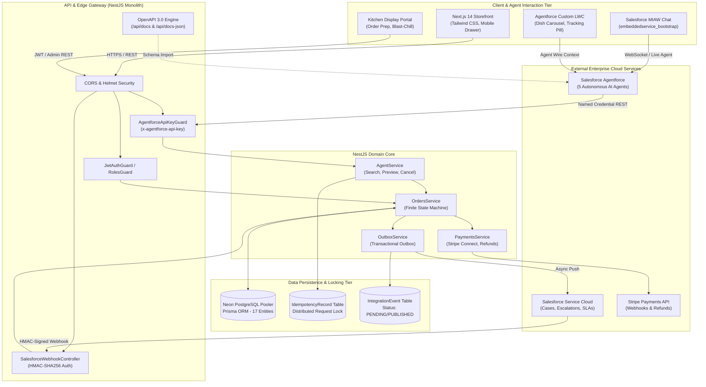
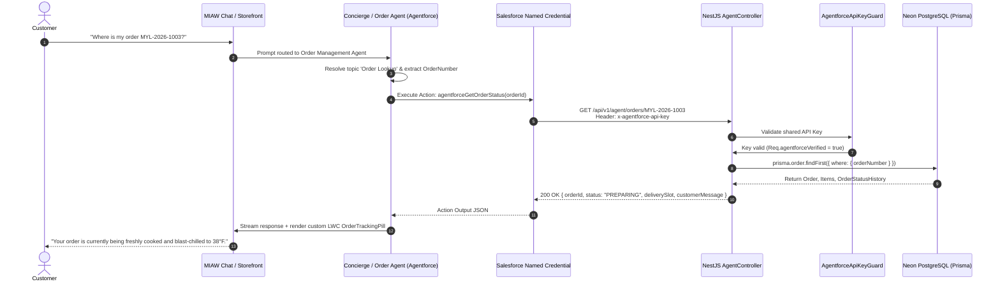
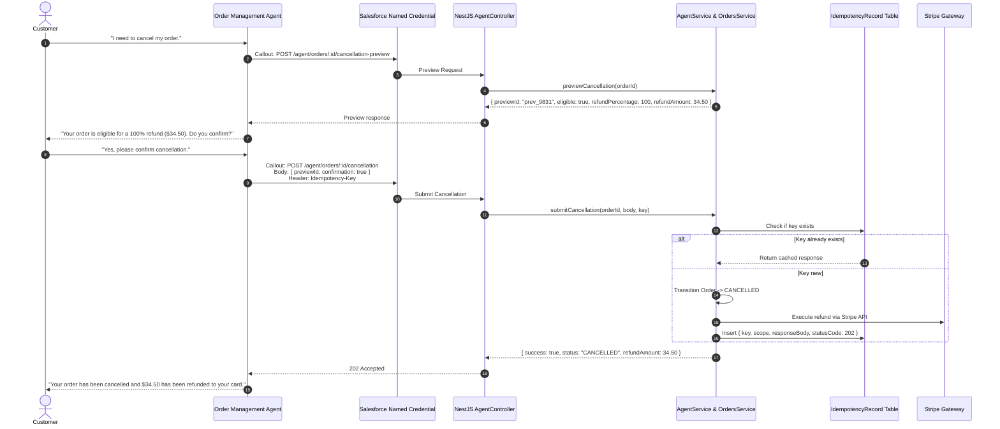
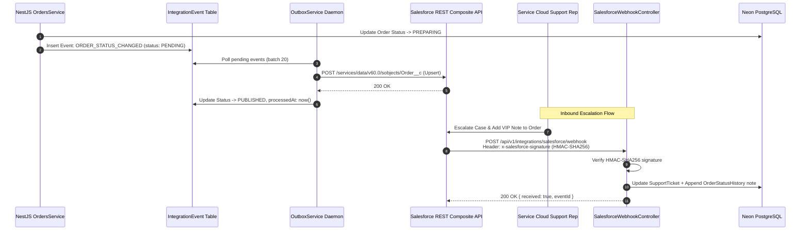

# Enterprise Architecture Specification — Mylapore Express
**Author**: Certified Technical Architect (CTA) / Principal Enterprise Solutions Architect  
**Project**: Mylapore Express Enterprise Restaurant E-Commerce & Autonomous Agentforce AI Network  
**Target Environments**:  
- Web: `https://mylapore-express-web.onrender.com`  
- API: `https://mylapore-express-api.onrender.com`  
- Database: Neon Serverless PostgreSQL (`ep-jolly-hat-a1w9iu5y-pooler.ap-southeast-1.aws.neon.tech/neondb`)  
- Salesforce: Service Cloud Enterprise Edition & Agentforce Autonomous Agent Suite  

---

## 1. Executive Summary & Architectural Tenets
Mylapore Express is an authentic South Indian enterprise culinary e-commerce platform architected according to **Spec-Driven Development (SDD)** and strict **zero-hallucination operational boundaries**:

1. **Single Writer per Business Fact**: NestJS API + PostgreSQL is the sole transactional authority for menus, carts, pricing, order states, and financial movements.
2. **Untrusted AI Orchestration**: Salesforce Agentforce AI agents operate strictly as conversational orchestrators. Agents have **zero direct database access** and must invoke authenticated, idempotent backend REST APIs.
3. **Idempotent Financial Boundaries**: Cancellation, rescheduling, and refund flows utilize two-phase commit tokens (`previewId`) and database-backed `IdempotencyRecord` concurrency locking to guarantee zero duplicate charges or refunds.
4. **Resilient Asynchronous Bi-directional Sync**: Outbound platform events flow via the Transactional Outbox Pattern (`IntegrationEvent`), while inbound operational escalations flow via HMAC-SHA256 signed webhooks (`SalesforceWebhookController`).
5. **Strict SLA & Latency Governance**: Callouts from Salesforce adhere to the hard 10-second platform timeout through cold-start keep-alive daemons, database connection pooling, and sub-second endpoint SLAs.

---

## 2. End-to-End Enterprise Architecture Topology

---

## 3. Data Ownership & System Boundaries

| Business Domain | Authoritative System (Writer) | Read Replicas / Snapshots | Consistency Model |
|---|---|---|---|
| **Catalog, Pricing & Tax** | NestJS / Neon PostgreSQL | Next.js Frontend / Agent Cache | Strong consistency (Real-time DB query) |
| **Cart & Active Quotes** | NestJS / Neon PostgreSQL | Browser Session Storage | Strong consistency (Server-side quote calculation) |
| **Order State Machine** | NestJS / Neon PostgreSQL | Salesforce `OrderSummary` & `OrderStatusHistory` | Eventual consistency via Transactional Outbox |
| **Payment Truth & Intent** | Stripe API + NestJS Verification | Salesforce `Payment` Record | Strong consistency via Stripe Webhook Inbox |
| **Refund Execution** | Stripe API (Triggered by NestJS) | Salesforce `Refund` Object | Strong consistency with DB `IdempotencyRecord` |
| **Support Cases & SLAs** | Salesforce Service Cloud | NestJS `SupportTicket` Table | Eventual consistency via Inbound Webhook (`SF_CASE_SYNC`) |
| **Autonomous AI Reasoning** | Salesforce Agentforce Reasoning Engine | Salesforce `AgentSession` & Audit Log | Ephemeral reasoning; concrete state written via API |

---

## 4. End-to-End Architectural Flows

### Flow A: Conversational Order Tracking & Status Ingestion

### Flow B: Idempotent Two-Phase Cancellation & Refund Flow

### Flow C: Outbox Asynchronous Sync & Inbound Webhook Flow

---

## 5. Security & Governance Architecture

### 5.1 Named Credential Authentication
Every callout executed by Agentforce passes through a dedicated Salesforce Named Credential:
- **Header**: `x-agentforce-api-key: <AGENTFORCE_API_KEY>`
- **Enforcement**: Handled at the NestJS router boundary by `AgentforceApiKeyGuard`. Requests missing or containing invalid keys are rejected immediately with `401 Unauthorized` before invoking service layers.

### 5.2 Inbound Webhook HMAC Verification
Webhooks dispatched from Salesforce Service Cloud to `POST /api/v1/integrations/salesforce/webhook` are protected with cryptographic signatures:
- **Header**: `x-salesforce-signature: <HMAC_HEX>`
- **Algorithm**: `crypto.createHmac('sha256', process.env.SALESFORCE_WEBHOOK_SECRET).update(rawPayload).digest('hex')`
- **Replay Protection**: Verified against unique `eventId` and recorded in `IntegrationEvent` with deduplication constraints.

### 5.3 OpenAPI 3.0 Compatibility for External Services
Salesforce External Services imposes strict validation rules on OpenAPI specifications:
- Every route registered for agent consumption provides an explicit, deterministic `operationId` (`agentforceSearchMenu`, `agentforceGetOrderStatus`, etc.).
- Schema types utilize strict primitive definitions (`string`, `number`, `boolean`, `array`).
- The live API exposes raw JSON at `GET /api/docs-json`, enabling one-click URL schema imports in Salesforce Setup.

---

## 6. Operational Resilience & Keep-Alive Strategy

### 6.1 Mitigation of 10-Second Salesforce Callout Limit
Salesforce Agentforce enforces a hard 10,000ms timeout on HTTP callouts. Cloud hosting providers on free/starter tiers (such as Render) suspend idle compute after 15 minutes of inactivity, introducing cold-start penalties of 30–50 seconds.

**Production Solution**:
1. **Keep-Alive Heartbeat Daemon**: A persistent cron or synthetic probe sends an authenticated lightweight `GET /api/v1/health` ping every 4 minutes.
2. **Neon Connection Pooling**: Database connections utilize Neon's PgBouncer pooler (`ep-jolly-hat-a1w9iu5y-pooler.ap-southeast-1.aws.neon.tech`), eliminating TLS handshake overhead during serverless query bursts.
3. **Sub-second Response Ceiling**: Heavy queries are indexed in PostgreSQL (`@@index([status, nextRetryAt])`, `@@index([orderNumber])`).

---

## 7. Monorepo Implementation Mapping

| Architecture Component | Codebase Implementation | Role & Responsibilities |
|---|---|---|
| **API Key Guard** | `apps/api/src/common/agentforce-api-key.guard.ts` | Guards `/agent/*` endpoints against unauthorized callers |
| **Agent Gateway Controller** | `apps/api/src/agent/agent.controller.ts` | Exposes OpenAPI actions with deterministic `operationId`s |
| **Agent Domain Logic** | `apps/api/src/agent/agent.service.ts` | Executes menu search, order retrieval, and cancellation preview |
| **Inbound Webhook Controller** | `apps/api/src/integrations/salesforce-webhook.controller.ts` | Ingests HMAC-signed events from Service Cloud |
| **Transactional Outbox** | `apps/api/src/integrations/outbox.service.ts` | Asynchronously transmits local events to Salesforce |
| **Idempotency Engine** | `apps/api/src/orders/orders.service.ts` + `Prisma.idempotencyRecord` | Guarantees exactly-once financial execution |
| **Storefront Chat Interface** | `apps/web/src/components/chat/ChatWidget.tsx` | Embeds MIAW / Web chat widget for customer interaction |
| **Mobile Web Experience** | `apps/web/src/components/cart/MobileCartBar.tsx` | Responsive 390px viewport navigation and checkout trigger |
