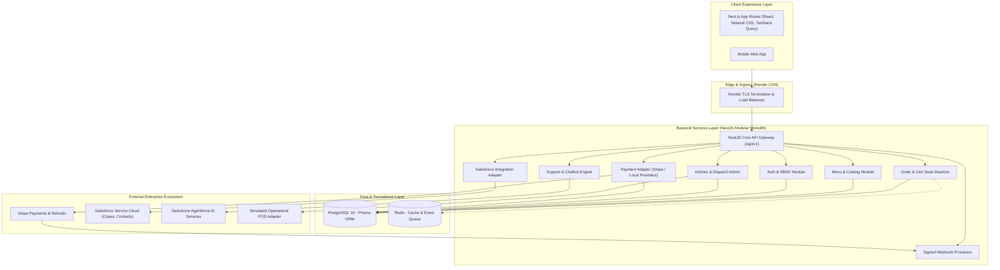

# System Architecture Document: Mylapore Express

- **Document ID**: SAD-ME-04
- **Version**: 2.0

---

## 1. High-Level Enterprise Topology



---

## 2. Architectural Decisions & Patterns

### ADR-001: Modular Monolith vs Microservices
- **Decision**: Adopt a Modular Monolith in NestJS with clean domain boundaries (`apps/api`), sharing types via `packages/shared-types`.
- **Justification**: Eliminates network hop overhead, distributed transaction failures, and complex service mesh overhead while allowing rapid development and effortless horizontal scaling on Render.

### ADR-002: Dual System of Record Principle
- **Operational Data (Transactional Master)**: PostgreSQL owns all customer accounts, menu items, orders, line items, payments, delivery statuses, and refund records.
- **CRM Data (Engagement Master)**: Salesforce Service Cloud owns support cases, omni-channel tickets, customer sentiment, and marketing segmentation. Sync occurs asynchronously.

### ADR-003: Idempotent Payment Flow
- **Pattern**: Stripe PaymentIntent creation with unique client order tokens. The order is stored initially with status `PENDING_PAYMENT`. The webhook handler verifies the cryptographic signature from Stripe and executes a transactional update:
```sql
UPDATE "Order" SET status = 'CONFIRMED' WHERE id = :orderId AND status = 'PENDING_PAYMENT';
```
If a duplicate webhook arrives, the query performs no mutation, guaranteeing exactly-once order confirmation.
