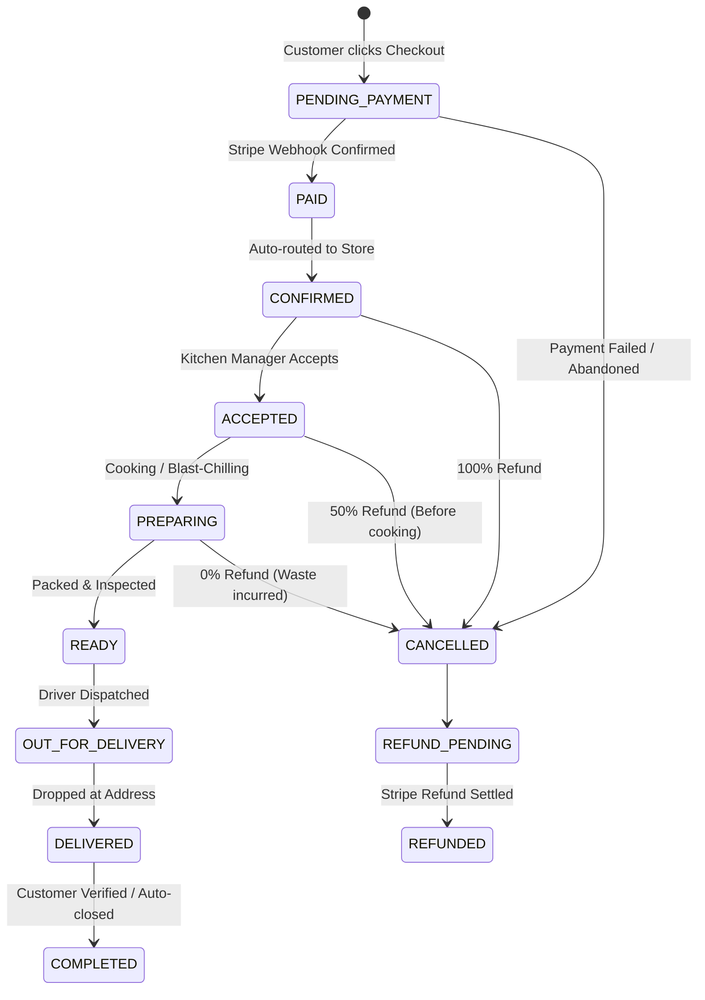

# Backend Specification: Mylapore Express

- **Document ID**: BSD-ME-06
- **Framework**: NestJS 10 / Node.js 20+
- **Persistence**: PostgreSQL 16 via Prisma ORM

---

## 1. Modular Architecture Breakdown

The backend service is structured into distinct, decoupled NestJS modules:

1. **`AuthModule`**:
   - Customer & Staff registration, JWT generation, bcrypt password hashing, RBAC guards (`SUPER_ADMIN`, `RESTAURANT_ADMIN`, `KITCHEN_MANAGER`, `DELIVERY_MANAGER`, `CUSTOMER_SUPPORT`, `CUSTOMER`).
2. **`MenuModule`**:
   - Category management, MenuItem CRUD, Dietary filtering (Jain, Vegan, Gluten-Free), Variant management (sizes, add-ons), Inventory availability status.
3. **`CartModule`**:
   - Server-side cart validation, merging guest sessions into customer accounts, stock checks.
4. **`CheckoutModule` & `PaymentsModule`**:
   - Server-side tax (8.25%), delivery surcharge, tip, discount coupon calculation.
   - Provider-abstracted Stripe PaymentIntent creation, webhook verification with replay protection, idempotent transaction tokens.
5. **`OrdersModule`**:
   - Order creation, deterministic state machine validator, order retrieval, kitchen acceptance, live status timeline, customer rescheduling logic, and operational cancellation.
6. **`RefundsModule`**:
   - Entitlement calculator based on order milestone, automated Stripe refund trigger, transactional refund ledger.
7. **`SupportModule`**:
   - In-app chatbot query engine, ticket creation, automated intent parsing, handoff to Salesforce Service Cloud cases.
8. **`IntegrationsModule`**:
   - Salesforce CRM REST synchronization, Agentforce AI tool endpoints, simulated POS interface.
9. **`AdminModule`**:
   - Operations dashboard, Kitchen Display System (KDS) feeds, inventory 86'ing, coupon management, audit trail logs.

---

## 2. Order State Machine Rules

