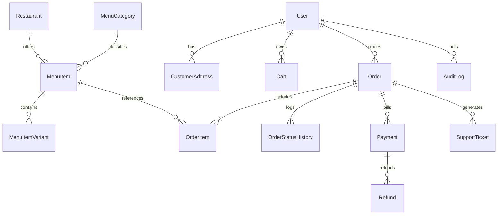

# Database Specification: Mylapore Express

- **Document ID**: DBD-ME-07
- **Database Engine**: PostgreSQL 16 (Render Managed PostgreSQL)
- **Object Relational Mapper**: Prisma ORM

---

## 1. Schema Entities & Relationship Model

---

## 2. Table Specifications & Precision Standards
- **Monetary Fields**: Stored as exact `Decimal(10, 2)` or `Int` in lowest currency cents/paise. Floating-point types (`Float` / `Double`) are strictly prohibited for financial amounts.
- **Enumerations**:
  - `UserRole`: `SUPER_ADMIN`, `RESTAURANT_ADMIN`, `KITCHEN_MANAGER`, `DELIVERY_MANAGER`, `CUSTOMER_SUPPORT`, `CUSTOMER`
  - `OrderStatus`: `PENDING_PAYMENT`, `PAID`, `CONFIRMED`, `ACCEPTED`, `PREPARING`, `READY`, `OUT_FOR_DELIVERY`, `DELIVERED`, `COMPLETED`, `CANCELLED`, `REFUND_PENDING`, `REFUNDED`
  - `PaymentStatus`: `REQUIRES_PAYMENT_METHOD`, `PROCESSING`, `SUCCEEDED`, `FAILED`, `CANCELLED`, `REFUNDED`
  - `OrderType`: `DELIVERY`, `PICKUP`
  - `DietaryTag`: `VEGETARIAN`, `VEGAN`, `JAIN`, `GLUTEN_FREE`, `NUT_FREE`
  - `SpiceLevel`: `MILD`, `MEDIUM`, `HOT`, `EXTRA_HOT`

## 3. High-Performance Indexing Strategy
- `Order(userId, createdAt DESC)`: Rapid retrieval of customer order history.
- `Order(status, scheduledDeliverySlot)`: Kitchen prep queue filtering.
- `MenuItem(categoryId, isAvailable)`: Millisecond catalog filtering.
- `Payment(stripePaymentIntentId)`: Unique constraint and O(1) webhook reconciliation.
- `IdempotencyKey(key, scope)`: Atomic duplicate request rejection.
