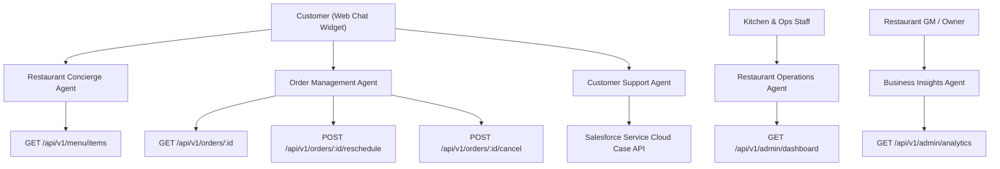

# Agentforce AI Specification: Mylapore Express

- **Document ID**: AFS-ME-11
- **Platform**: Salesforce Agentforce AI Engine & Autonomous Agent Architecture

---

## 1. Agent Network Architecture

## 2. Agent Catalog & Actions

### Agent 1: Restaurant Customer Concierge Agent
- **Business Purpose**: Guide discovery of authentic South Indian dishes, accommodate dietary constraints (Jain, Vegan, Gluten-Free), explain blast-chilled freshness.
- **Tools**:
  - `searchDishes(query, dietaryFilter, spiceLevel)`
  - `explainDishHeritage(dishName)`
  - `getReheatingInstructions(dishName)`

### Agent 2: Order Management Agent
- **Business Purpose**: Provide instantaneous order tracking, validate rescheduling windows, and process policy-compliant cancellations.
- **Tools**:
  - `lookupOrder(orderNumber, customerPhone)`
  - `checkRescheduleEligibility(orderId)`
  - `executeReschedule(orderId, newSlot)`
  - `calculateCancellationRefund(orderId)`
  - `executeCancellation(orderId, reason)`

### Agent 3: Customer Support Agent
- **Business Purpose**: Handle complaints (cold delivery, missing item), automatically generate Salesforce Service Cloud Cases, compute sentiment score, and initiate agent handoff.
- **Tools**:
  - `createServiceCase(customerId, subject, description, priority)`
  - `escalateToHumanQueue(caseId, reason)`

### Agent 4: Operations & Kitchen Agent
- **Business Purpose**: Alert kitchen supervisors of preparation backlog thresholds, delivery driver transit delays, and blast-chilling temperature logs.

### Agent 5: Restaurant Insights Agent
- **Business Purpose**: Summarize top-selling dishes (e.g. Potato Kara Kari, Bisi Bele Bath), peak ordering hours, and customer retention metrics for restaurant executives.
