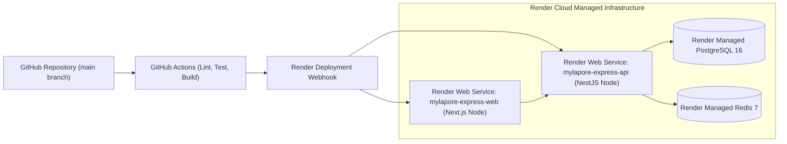

# Deployment & Cloud Infrastructure Specification: Mylapore Express

- **Document ID**: DIS-ME-13
- **Primary Cloud Provider**: Render Cloud Platform
- **CI/CD Orchestration**: GitHub Actions

---

## 1. Cloud Architecture on Render

## 2. Infrastructure as Code (`render.yaml`) Specification
- `apps/web`: Node environment, Build: `pnpm install && pnpm build:web`, Start: `pnpm --filter @mylapore/web start`, Port: `3000`.
- `apps/api`: Node environment, Build: `pnpm install && pnpm build:api && pnpm prisma:migrate:deploy`, Start: `pnpm --filter @mylapore/api start:prod`, Port: `4000`.
- `postgres`: Managed PostgreSQL database with automated daily backups.
- `redis`: Key-value store for caching and session state.

## 3. Migration & Rollback Strategy
- Non-destructive Prisma migrations (`prisma migrate deploy`) execute during pre-deploy phases.
- Zero-downtime rolling deploys ensure active checkout requests complete without dropping client sessions.
